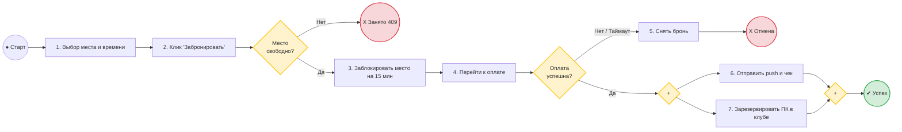

# Colizeum: Аналитика загрузки клубов и проектирование системы бронирования

Проект системного и продуктового анализа для сети киберспортивных клубов **Colizeum**. 
Включает проектирование реляционной схемы данных, отказоустойчивого REST API метода бронирования, аналитического SQL-запроса расчёта утилизации (с краевыми случаями) и BPMN-схемы процесса.

---

## 📁 Структура репозитория

```text
├── schema.sql              # DDL: Схема БД 
├── seed_data.sql           # Тестовые данные для проверки краевых случаев
├── utilization_query.sql   # Аналитический SQL-запрос расчета недельной загрузки
├── booking_process.bpmn    # BPMN 2.0 XML диаграмма
└── README.md               # Документация проекта и спецификация метода API
```

* **Схема БД (DDL):** [`schema.sql`](./schema.sql)
* **Тестовый датасет:** [`seed_data.sql`](./seed_data.sql)
* **SQL-запрос утилизации:** [`utilization_query.sql`](./utilization_query.sql)
* **BPMN-диаграмма (XML):** [`booking_process.bpmn`](./booking_process.bpmn)

---

## 1. Схема базы данных

Реляционная модель спроектирована в 3-й нормальной форме (3NF):

```text
[ clubs ] 1 ──< [ seats ] 1 ──< [ sessions ]
                    │
                    ├──< [ bookings ]
                    │
                    └──< [ unavailable ]
```

* **`clubs`** — справочник клубов сети и их часовых поясов.
* **`seats`** — реестр игровых ПК с разделением по категориям (`Standard`, `VIP`, `Bootcamp`).
* **`bookings`** — резервы пользователей со статусами (`PENDING`, `CONFIRMED`, `CANCELLED`).
* **`sessions`** — фактические посадки игроков. Поле `time_end = NULL` обозначает активную сессию.
* **`unavailable`** — журнал ремонтов/простоев оборудования для корректировки доступного фонда часов.

Подробные DDL-скрипты с внешними ключами и индексами: [`schema.sql`](./schema.sql).

---

## 2. Аналитический расчет загрузки (Utilization Rate)

### Бизнес-формула:
$$\text{Utilization Rate (\%)} = \frac{\sum \text{Часы сыгранных сессий}}{\text{Общий фонд доступных часов}} \times 100\%$$
$$\text{Общий фонд} = (\text{Количество ПК} \times 168\text{ часов}) - \sum \text{Часы ремонтов}$$

### Граничные случаи, решенные в запросе:
1. **Интервальная обрезка :** Функции `GREATEST(start, week_start)` и `LEAST(end, week_end)` отсекают часы сессий, выходящие за пределы прошлой недели (например, игра с воскресенья на понедельник).
2. **Активные сессии:** Для сессий со статусом «играет сейчас» (`time_end IS NULL`) используется `COALESCE(time_end, NOW())`.
3. **Безопасность вычислений:** Предотвращение деления на ноль через `NULLIF(...)` и приведение к `::numeric` для округления `ROUND(..., 2)`.

Полный исполняемый запрос с комментариями: [`utilization_query.sql`](./utilization_query.sql).  
Набор тестовых данных для валидации краевых случаев: [`seed_data.sql`](./seed_data.sql).

---

## 3. Спецификация API: Метод `POST /api/v1/bookings`

Метод предназначен для оформления предварительной брони ПК и холдирования места на 15 минут для оплаты.

### HTTP Заголовки:
* `Authorization: Bearer <jwt_token>` (обязательный) — токен авторизованного клиента.
* `X-Idempotency-Key: <UUIDv4>` (обязательный) — ключ идемпотентности для защиты от повторных списаний при дабл-кликах и сбоях сети.
* `Content-Type: application/json`

### Тело запроса (Request Body):
```json
{
  "seat_id": 42,
  "time_start": "2026-11-15T18:00:00Z",
  "time_end": "2026-11-15T22:00:00Z"
}
```

> **Важно:** `user_id` и стоимость `price` из соображений безопасности не принимаются от клиента: бэкенд извлекает `user_id` из JWT-токена, а `price` рассчитывает на основе тарифной сетки клуба.

### Таблица ответов:

| Код | Статус | Ситуация | Тело ответа |
| :---: | :--- | :--- | :--- |
| **`201`** | `Created` | Бронь успешно создана, запущен таймер на 15 мин | `{"booking_id": "...", "price": 1200, "status": "PENDING", "expires_at": "..."}` |
| **`400`** | `Bad Request` | Ошибка валидации (`time_end <= time_start` или время в прошлом) | `{"error": "VALIDATION_FAILED", "message": "Invalid time interval"}` |
| **`401`** | `Unauthorized` | Отсутствует, просрочен или подделан JWT-токен | `{"error": "UNAUTHORIZED", "message": "Token required"}` |
| **`403`** | `Forbidden` | Пользователь заблокирован в клубе | `{"error": "FORBIDDEN", "message": "Account suspended"}` |
| **`404`** | `Not Found` | Передан несуществующий `seat_id` | `{"error": "NOT_FOUND", "message": "Seat does not exist"}` |
| **`409`** | `Conflict` | Место уже занято на это время или находится в ремонте | `{"error": "SEAT_BUSY", "message": "Seat already reserved"}` |

### Защита от дублей и Race Condition:
1. **Frontend:** Блокировка кнопки в UI (`disabled`) сразу после первого нажатия со спиннером ожидания.
2. **Идемпотентность (Redis):** По ключу `X-Idempotency-Key` сервер фиксирует статус обработки. При дублирующем сетевом запросе возвращается сохранённый результат первого ответа без создания дублирующей записи.
3. **Изоляция транзакций в БД:** Защита от одновременного клика двух пользователей на одно место через блокировку строки `SELECT ... FOR UPDATE` по `seat_id`.

---

## 4. Процесс бронирования (BPMN 2.0)

Файл схемы в стандартном XML формате: [`booking_process.bpmn`](./booking_process.bpmn).

### Визуализация логики процесса:



### Разбор шлюзов:
* **Шлюз XOR (Exclusive) «Место свободно?»**: ветвление взаимно исключающих исходов (`409 Conflict` или временная блокировка места).
* **Шлюз XOR (Exclusive) «Оплата успешна?»**: проверка ответа эквайринга с учетом 15-минутного таймаута удержания места.
* **Шлюзы AND (Parallel Fork & Join)**: распараллеливание уведомления игрока и блокировки ПК в локальном софте клуба с последующей синхронизацией потоков перед завершением.

---

## 5. Граничные сценарии (Edge Cases)

* **Запоздалый вебхук банка (>15 мин):** Если оплата подтвердилась после отмены брони по таймауту, бэкенд видит статус `CANCELLED`, автоматически инициирует `Refund API` и отправляет клиенту уведомление о возврате денег.
* **Сбой питания ПК во время сессии:** Активные сессии (`time_end IS NULL`) обрабатываются через `COALESCE(time_end, NOW())`, а фоновая программа закрывает сессии по отсутствию heartbeat-сигнала дольше 10 минут.
